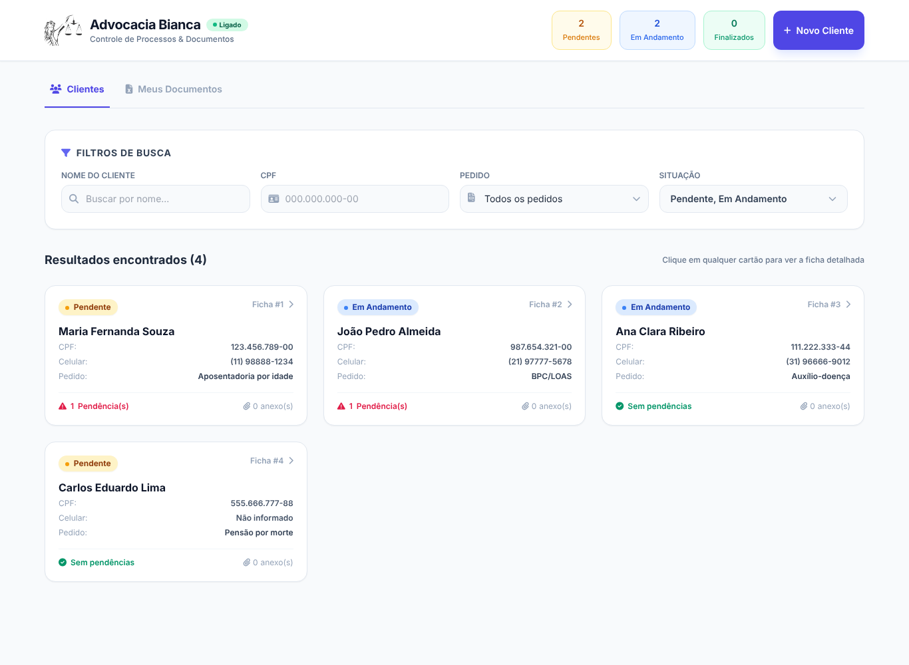
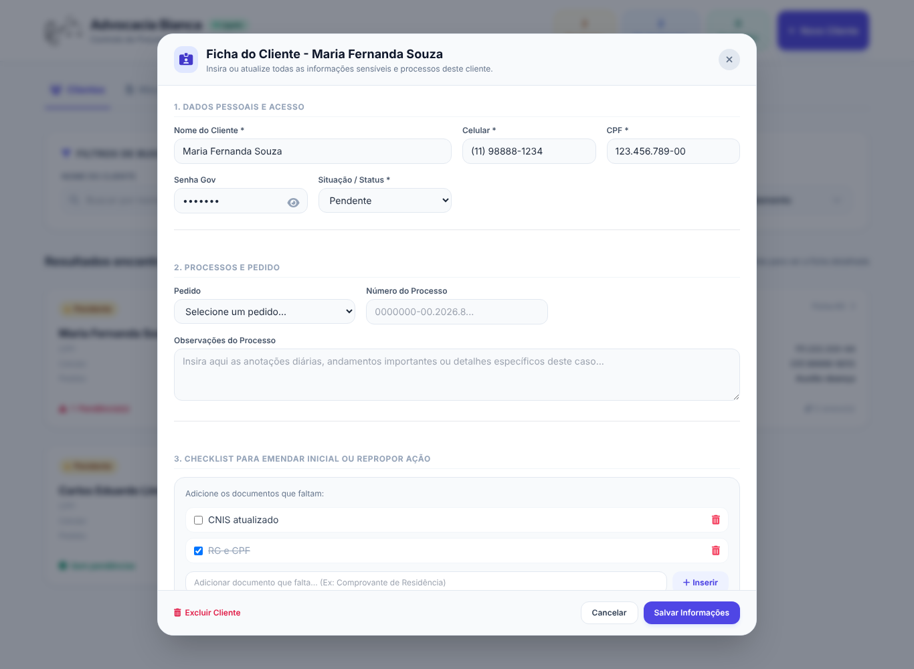

# ⚖️ Gestão Advocacia

Sistema web para um escritório de advocacia organizar **clientes, processos e documentos** em um só lugar. Desenvolvido para uso real em um escritório que atua com pedidos previdenciários (aposentadorias, BPC/LOAS, auxílios), substituindo o controle feito em planilhas e pastas soltas.



## ✨ Funcionalidades

- **Fichas de clientes (CRUD)** — cadastro com dados pessoais, pedido administrativo, protocolo, número do processo e observações
- **Controle de situação** — clientes classificados como *Pendente*, *Em Andamento* ou *Finalizado*, com contadores no topo da tela
- **Filtros de busca** por nome, CPF, tipo de pedido e situação
- **Checklist de documentos faltantes** por cliente (marcar como entregue)
- **Anexos** — upload de PDFs, imagens e planilhas vinculados a cada cliente
- **Meus Documentos** — área de arquivos gerais do escritório (modelos, procurações etc.)
- **Criptografia da Senha Gov** com AES-256-CBC antes de gravar no banco
- **Script de backup** (`backup.cmd`) que copia o banco e os anexos para outro disco



## 🛠️ Tecnologias

| Camada | Tecnologias |
|---|---|
| Backend | Node.js, Express 5, Multer (uploads), módulo `crypto` |
| Banco de dados | SQLite 3 |
| Frontend | HTML, Alpine.js, Tailwind CSS, Font Awesome |

## 🚀 Como rodar

Pré-requisito: [Node.js](https://nodejs.org/) 18 ou superior.

```bash
git clone https://github.com/oliversoriano/Gestao-Advocacia.git
cd Gestao-Advocacia
npm install
npm start
```

Acesse **http://localhost:3000**. O banco `database.db` e a pasta `uploads/` são criados automaticamente na primeira execução.

No Windows também é possível iniciar com um duplo clique em `iniciar_server.bat`.

### Variáveis de ambiente (opcional)

Copie `.env.example` e defina os valores no ambiente:

| Variável | Descrição | Padrão |
|---|---|---|
| `PORT` | Porta do servidor | `3000` |
| `ENCRYPTION_KEY` | Chave de criptografia da Senha Gov | chave de desenvolvimento |

## 📡 API

| Método | Rota | Descrição |
|---|---|---|
| `GET` | `/api/clients` | Lista clientes com pendências e anexos |
| `POST` | `/api/clients` | Cria cliente |
| `PUT` | `/api/clients/:id` | Atualiza cliente |
| `DELETE` | `/api/clients/:id` | Remove cliente e seus anexos |
| `POST` | `/api/clients/:id/upload` | Anexa arquivo ao cliente |
| `DELETE` | `/api/clients/:clientId/files/:fileId` | Remove anexo |
| `GET` | `/api/global-documents` | Lista documentos gerais |
| `POST` | `/api/global-documents` | Envia documento geral |
| `DELETE` | `/api/global-documents/:id` | Remove documento geral |

## 📁 Estrutura

```
Gestao-Advocacia/
├── server.js            # API Express + SQLite
├── app.html             # Interface (Alpine.js + Tailwind)
├── img/                 # Ícones e logo
├── docs/                # Capturas de tela do README
├── backup.cmd           # Backup do banco e anexos (Windows)
├── iniciar_server.bat   # Atalho para iniciar no Windows
└── .env.example
```

## 🔐 Sobre os dados

O sistema roda localmente no computador do escritório. O banco de dados e os anexos **não** fazem parte do repositório (`.gitignore`), e as imagens acima usam apenas dados fictícios.

## 🗺️ Próximos passos

- [ ] Autenticação de usuários (login)
- [ ] Proteger a rota `/uploads` para exigir login
- [ ] Separar o frontend em arquivos (`index.html`, `app.js`, `styles.css`)
- [ ] Testes automatizados da API (Jest + Supertest)
- [ ] Reduzir consultas ao banco na listagem de clientes (JOIN em vez de uma consulta por cliente)

## 👤 Autor

**Oliver Soriano** — [GitHub](https://github.com/oliversoriano)

Licença [MIT](LICENSE).
